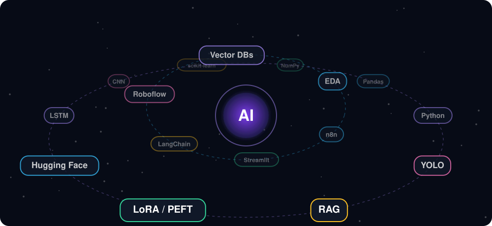
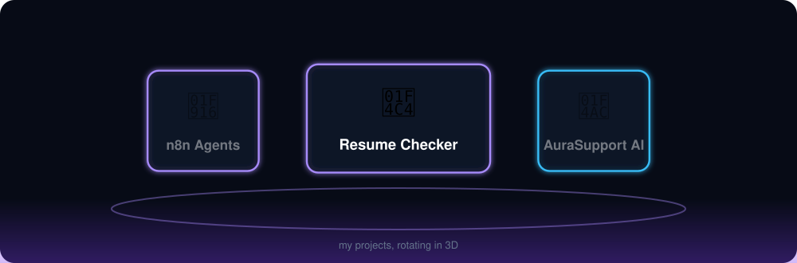

  

  
  

## 👋 About me

I’m an **AI Engineer, Data Scientist and ML Engineer**. After a year of hands-on AI and data science training, I build predictive models, fine-tuned LLMs, multi-agent automations and deployed Streamlit apps. Every project below is public, and most have a live demo.

## 🪐 Skill orbit

  

| Area | What I use |
|---|---|
| **Python & Data** | Python, OOP, NumPy, Pandas, Matplotlib, Seaborn, EDA, feature engineering |
| **Machine Learning** | Supervised regression and classification, unsupervised learning, scikit-learn |
| **Deep Learning** | ANN, CNN, RNN, LSTM, TensorFlow/Keras, PyTorch |
| **GenAI & LLMs** | Hugging Face, model APIs, LoRA fine-tuning, RAG, vector databases, LangChain |
| **Computer Vision** | YOLO, Roboflow dataset annotation, CNN classifiers |
| **Automation & Apps** | n8n multi-agent workflows, Streamlit |

## 🎠 Project carousel

  

## 🚀 Featured projects

| Project | What it does | Stack | Links |
|---|---|---|---|
| 📄 **AI HR Resume Checker** | Screens and ranks resumes against a job description with match scores, skill gaps, hire recommendations and interview questions | Gemini · LangChain · Streamlit | [Code](https://github.com/turningpoint0125-rgb/Ai-hr-resume-checker) · [Live](https://ai-hr-resume-checker-6pzfb9ydvv46k9gurvepze.streamlit.app/) |
| 💬 **AuraSupport AI** | Customer-support chatbot: flan-t5-small fine-tuned with LoRA on 20k Bitext samples | LoRA · PEFT · Hugging Face · Streamlit | [Code](https://github.com/turningpoint0125-rgb/Ai-Customer-Support-chatbot-Fine-Tuning) · [Live](https://ai-customer-support-chatbot-fine-tuning.streamlit.app/) |
| 🏦 **Bank Churn Predictor** | Predicts customer churn with probability using Gradient Boosting | scikit-learn · Streamlit | [Code](https://github.com/turningpoint0125-rgb/Bank-Churn-Predictor) · [Live](https://bank-churn-predictor-qwtdg694w8tgvb3hqpqqjl.streamlit.app/) |
| 🚗 **VELOCITY Car Price Predictor** | Estimates sports-car prices with Ridge and Linear Regression and a price-driver breakdown | scikit-learn · Plotly · Streamlit | [Code](https://github.com/turningpoint0125-rgb/Car-Price-Predictor) · [Live](https://car-price-predictor-ureopa3z5umbrue6tjeprm.streamlit.app/) |
| 🖼️ **VisionAI CNN Studio** | No-code studio to build a dataset, train a CNN, evaluate and predict | TensorFlow · Keras · Streamlit | [Code](https://github.com/turningpoint0125-rgb/CNN-Image-Classifier) · [Live](https://cnn-image-classifier-namgabuedfmu3n5mjswifv.streamlit.app/) |
| 🌦️ **Weather Analytics Dashboard** | Live weather, forecast, trend charts and insights for any city | OpenWeatherMap · Pandas · Streamlit | [Code](https://github.com/turningpoint0125-rgb/Weather-app) · [Live](https://weather-app-7rbecpbckcy5pf7kddwaqp.streamlit.app/) |
| 📰 **Article Supervisor Pipeline** | Multi-agent n8n pipeline: research, write, compile a Google Doc | n8n · AI agents · Google Docs API | [Code](https://github.com/turningpoint0125-rgb/N8n-supervisor-articel-workflow-) |
| 📧 **Email Workflow Agent** | Chat-driven n8n agent that reads, sends and replies to Gmail | n8n · Gmail API · OpenRouter | [Code](https://github.com/turningpoint0125-rgb/Email-Workflow) |
| 📊 **Data Analysis & Advanced Pandas** | Cleaning, EDA and feature engineering on messy real-world datasets | Pandas · Seaborn · Matplotlib | [Code](https://github.com/turningpoint0125-rgb/Data-Analyst-and-Pandas) |

## 📬 Let’s connect

Open to AI engineer, data science and ML engineer roles, and to collaboration.
**GitHub:** [github.com/turningpoint0125-rgb](https://github.com/turningpoint0125-rgb) · **3D portfolio:** [turningpoint0125-rgb.github.io](https://turningpoint0125-rgb.github.io/)

---

Always learning · always building 🚀

